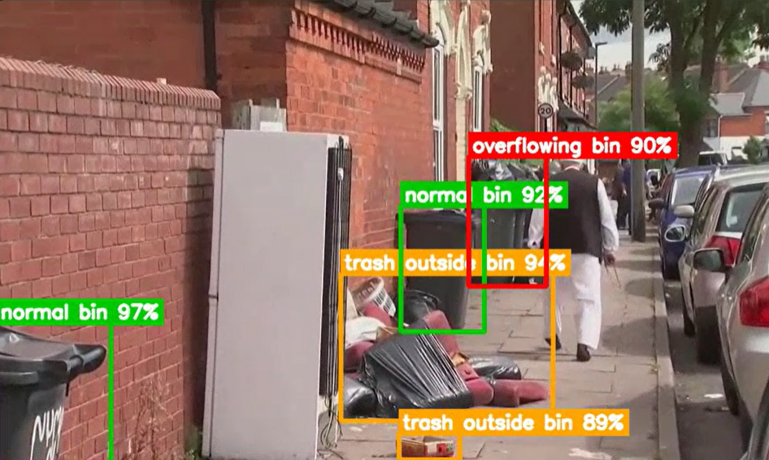

# CivicLens AI  


## Computer Vision-Based Waste Monitoring System


\*\*CivicLens AI\*\* is a video-based waste monitoring platform that applies computer vision to identify garbage bins, waste accumulation and overflowing waste conditions in outdoor environments.


The system processes uploaded video footage through an AI inference pipeline and presents annotated visual results and detection analytics through a web-based dashboard.


It combines object detection, video processing and a RESTful backend to provide a practical foundation for intelligent waste-monitoring applications.


\---


## Overview


Urban waste overflow is a recurring infrastructure and public-cleanliness challenge. Manual inspection of public spaces can be time-consuming and difficult to scale.


CivicLens AI explores how computer vision can assist waste-monitoring workflows by analyzing visual footage and identifying relevant waste conditions.


\*\*Core objective:\*\* Convert unstructured video footage into structured visual detection results that can support waste-monitoring and inspection activities.


## Key Capabilities


| Capability          | Description                                              |

| ------------------- | -------------------------------------------------------- |

| Video ingestion     | Upload video footage for analysis                        |

| Object detection    | Identify waste-related objects using trained YOLO models |

| Overflow monitoring | Detect visible waste outside garbage bins                |

| Video annotation    | Generate videos containing detection annotations         |

| Detection analytics | Present processing and detection results                 |

| Model selection     | Support configured original and candidate models         |

| External inference  | Integrate with a configured Roboflow workflow            |

| REST API            | Expose endpoints for uploads, jobs and results           |

## Visual Detection Results

The following image demonstrates the waste detection and annotation output generated by CivicLens AI.




## System Architecture


```mermaid

flowchart TD

&#x20;   A\[User] --> B\[Web Dashboard]

&#x20;   B --> C\[FastAPI Backend]

&#x20;   C --> D\[Video Upload and Job Management]

&#x20;   D --> E\[Inference Worker]

&#x20;   E --> F\[Model Selection]

&#x20;   F --> G\[YOLO Object Detection]

&#x20;   F --> H\[Roboflow Inference]

&#x20;   G --> I\[Detection Processing]

&#x20;   H --> I

&#x20;   I --> J\[Annotated Video]

&#x20;   I --> K\[Analysis Results]

&#x20;   J --> L\[Dashboard]

&#x20;   K --> L

```


### Processing Workflow


1\. A user uploads a video through the dashboard.

2\. The FastAPI backend receives the upload and manages the analysis job.

3\. The inference worker loads the configured detection model.

4\. Video frames are processed through the selected inference pipeline.

5\. Detection outputs are used to generate annotated video and analysis results.

6\. The dashboard retrieves and displays the processed outputs.


## Technology Stack


| Layer                    | Technologies           |

| ------------------------ | ---------------------- |

| Language                 | Python                 |

| Computer Vision          | OpenCV                 |

| Object Detection         | Ultralytics YOLO       |

| Backend Framework        | FastAPI                |

| ASGI Server              | Uvicorn                |

| Frontend                 | HTML, CSS, JavaScript  |

| Video Processing         | ImageIO-FFmpeg         |

| External Model Inference | Roboflow Inference SDK |


## Repository Structure


```text

civiclens-ai/

│

├── backend/

│   └── main.py

│

├── frontend/

│   └── index.html

│

├── worker/

│   └── worker.py

│

├── models/

│   └── best.pt

│

├── tools/

│   ├── check\_dataset.py

│   ├── check\_model.py

│   ├── compare\_sizes.py

│   ├── inspect\_dataset.py

│   ├── make\_contact\_sheet.py

│   ├── prepare\_frames.py

│   ├── test\_roboflow.py

│   └── validate\_dataset.py

│

├── .env.example

├── .gitignore

├── requirements.txt

└── README.md

```


\*The repository structure above represents the intended source-code layout. Optional model artifacts and generated directories depend on the repository distribution.\*


\## Getting Started


### Prerequisites


\- Python 3.11

\- Git

\- pip

\- A compatible operating environment

\- Sufficient memory and processing resources for video inference


### 1. Clone the repository


```bash

git clone https://github.com/myogeswar65-cmd/civiclens-ai.git

cd civiclens-ai

```


\### 2. Create a virtual environment


\*\*Windows:\*\*


```cmd

python -m venv venv

venv\\Scripts\\activate

```


\*\*Linux/macOS:\*\*


```bash

python3 -m venv venv

source venv/bin/activate

```


\### 3. Install dependencies


```bash

python -m pip install --upgrade pip

pip install -r requirements.txt

```


\### 4. Configure environment variables


Create a `.env` file in the repository root.


```env

ROBOFLOW\_API\_KEY=your\_api\_key\_here

```


The API key is needed only when using the external Roboflow inference workflow.


Never commit credentials, tokens or private environment configuration.


\### 5. Configure model artifacts


Place the required trained model at:


```text

models/best.pt

```


The candidate model must also be available at the path configured in `worker/worker.py` if you intend to use that model option.


\### 6. Start the backend


```bash

uvicorn backend.main:app --reload

```


\### 7. Access the dashboard


Open:


```text

http://127.0.0.1:8000/dashboard

```


The backend also exposes its interactive API documentation at:


```text

http://127.0.0.1:8000/docs

```


\## API Reference


The backend exposes the following application endpoints.


| Method | Endpoint                     | Purpose                   |

| ------ | ---------------------------- | ------------------------- |

| GET    | `/`                          | API status                |

| GET    | `/health`                    | Health check              |

| GET    | `/dashboard`                 | Web dashboard             |

| GET    | `/api/model-info`            | Model information         |

| POST   | `/api/upload`                | Upload video              |

| GET    | `/api/jobs`                  | Retrieve jobs             |

| GET    | `/api/jobs/{job\_id}`         | Retrieve job details      |

| POST   | `/api/jobs/{job\_id}/analyze` | Start analysis            |

| GET    | `/api/jobs/{job\_id}/video`   | Retrieve annotated video  |

| GET    | `/api/jobs/{job\_id}/results` | Retrieve analysis results |


For request schemas and interactive API exploration, use the FastAPI Swagger interface at `/docs`.


## Model and Inference


CivicLens AI uses trained YOLO object-detection models to identify waste-related visual patterns.


The inference pipeline supports:


\- Locally configured YOLO model inference.

\- Selection between original and candidate model configurations.

\- An optional external Roboflow inference workflow.


Detection quality depends on training-data coverage, image resolution, lighting, occlusion, camera angle and environmental conditions.


Model performance should be evaluated on representative, independently annotated footage before operational deployment.


## Engineering Considerations


\### Separation of responsibilities


The application separates the presentation layer, API layer and inference-processing logic.


\- \*\*Frontend:\*\* User interaction and visualization.

\- \*\*Backend:\*\* Request handling, uploads and job management.

\- \*\*Worker:\*\* Video processing and model inference.

\- \*\*Models:\*\* Trained model artifacts.

\- \*\*Tools:\*\* Dataset inspection and model-development utilities.


### Configuration and security


\- Environment-specific credentials are stored outside source control.

\- Large datasets and generated artifacts are excluded from the source repository.

\- Model artifacts are managed separately from application code.

\- API and inference behavior should be validated before production deployment.


## Limitations


\- The current implementation processes uploaded video rather than providing a complete live CCTV monitoring service.

\- Detection performance is sensitive to environmental conditions and footage quality.

\- Visual detections do not independently establish the actual weight or volume of waste.

\- Automated alerts, multi-camera orchestration and production-scale monitoring are not claimed as implemented features.


\## Future Development


Potential engineering extensions include:


\- Live CCTV stream integration.

\- GPU-accelerated cloud inference.

\- Multi-location monitoring.

\- Historical detection analytics.

\- Event-based notification workflows.

\- Model evaluation and monitoring pipelines.

\- Scalable deployment and observability.


## Author


\*\*M. Yogeswar\*\*

AI Engineer | Computer Vision | Generative AI


\---


## License and Third-Party Components


This project uses Ultralytics YOLO. The installed Ultralytics package is distributed under the AGPL-3.0 license.


Review the applicable licensing requirements for the model, dependencies and any external inference services before redistribution or commercial deployment.


\---


\*\*CivicLens AI — Turning Visual Data into Actionable Waste-Monitoring Insights.\*\*
